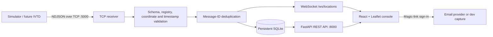

# NavIC — College Bus Tracking and Management System (CBTMS)

A full-stack Intelligent Vehicle Tracking System prototype for a college bus fleet. It combines a newline-delimited JSON telemetry receiver, a FastAPI + SQLAlchemy backend, a persistent local SQLite fleet database, WebSocket updates, and a React + Leaflet operations console.

> **No hardware is connected in this repository.** Every bundled simulator frame carries `simulated: true`. Coordinates, vehicles, drivers, tracker identifiers and routes are demo data, not surveyed or operational records. The exact IVTD hardware, modem and GNSS receiver output remain unverified; see [GNSS_COMPATIBILITY.md](docs/GNSS_COMPATIBILITY.md).

## Architecture



The TCP receiver is started inside the FastAPI lifespan by `backend/run.py`. HTTP and WebSocket share the same process and SQLAlchemy store.

## Current feature set

- Live fleet map, per-vehicle detail, playback history, trips and reports.
- Vehicle, driver, route, tracking-device, geofence, alert and system-setting management.
- Designated administrator password sign-in and normal user email magic-link sign-in with database-backed sessions.
- Roles: `admin`, `transport` (transport manager) and `viewer`.
- Audit trail for authentication and management actions.
- Additive schema migration for older development databases.
- Six-bus demo fleet (`IVTD_BUS_01`–`IVTD_BUS_06`) around the HKBK College of Engineering area in Bengaluru.

## Requirements

- Python 3.11+ (the project is currently exercised on Python 3.14).
- Node.js + npm for the frontend.
- SQLite is the local database; no external database account is required.

Run `./setup-fedora.sh` once, then `./start-navic.sh` to start both servers.
The database is stored under `~/.local/share/navic/` (or `$NAVIC_DATA_DIR`).
On its first launch, NavIC safely copies the old root `navic_dev.db` into that
location if no local database exists. The source database is left untouched.

Copy [`.env.example`](.env.example) to `.env` only if you need to customize local settings. `BACKEND_URL` is the single backend address used by the backend listener and Vite's development proxy (default `http://localhost:8000`). Browser API and WebSocket requests use relative `/api` and `/ws` URLs. The development entry points (`backend/run.py`, `backend/python_sqlalchemy/database/seed.py`, `navic_tcp/manage_users.py`, `navic_tcp/client_main.py`) load `.env` without overriding variables already exported in the shell. Never commit real credentials.

---

## Local development

### Setup

```bash
./setup-fedora.sh
```

### Start the application

```bash
./start-navic.sh
```

Before first startup on an existing database, apply additive schema changes:

```bash
.venv-local/bin/alembic -c backend/alembic.ini upgrade head
```

Open <http://localhost:5173>. FastAPI docs are at <http://localhost:8000/docs>
and its health check is <http://localhost:8000/health>. Press Ctrl+C to stop
both services. The backend starts the existing TCP receiver on `127.0.0.1:5000`.
The authentication bypass remains controlled by `DEMO_AUTH_BYPASS` (default
`false` in `.env.example`); a real account session takes precedence while the
development demo identity is available. For production, serve the built SPA
and reverse-proxy same-origin `/api`, other backend REST paths, and `/ws` to
FastAPI; configure `BACKEND_URL` to the public backend URL and keep the usual
PostgreSQL `DATABASE_URL` and secure cookie settings.

### Optional: seed the demo fleet

The seed is idempotent and never drops or resets existing records. It creates
or updates demo fleets, vehicles, tracking devices, drivers, routes and one
campus geofence.

```bash
.venv-local/bin/python -m backend.python_sqlalchemy.database.seed
```

The seed is idempotent and never drops or resets existing records. It creates or updates:

- demo fleet and sample operational records (no administrator credentials),
- demo drivers, two demo routes and one campus geofence,
- vehicles and tracking devices `IVTD_BUS_01`–`IVTD_BUS_06`,
- marks the six demo tracking devices `simulated=true` because only the simulator feeds them.

### Send simulated telemetry

In another terminal:

```bash
.venv-local/bin/python -m navic_tcp.client_main \
  --host 127.0.0.1 --port 5000 \
  --registry config/devices.demo.json \
  --devices 6 --interval 1 --continuous
```

The simulator defaults to `config/devices.demo.json`, uses the same IDs as the seeded fleet, and keeps all paths within roughly 2 km of the campus demo origin (`13.0435, 77.6200`). Each bus follows a smooth repeating elliptical path with a different radius, phase and direction. Speeds vary realistically (roughly 13–36 km/h) and each bus has short zero-speed stops. Paths are illustrative, **not** real road routes.

Useful simulator options:

```bash
# finite run: 20 frames per device
python -m navic_tcp.client_main --devices 6 --count 20 --interval 0.2

# one device only
python -m navic_tcp.client_main --device-id IVTD_BUS_03 --devices 1 --count 5

# move the synthetic origin
python -m navic_tcp.client_main --base-lat 13.0435 --base-lon 77.6200

# if DEVICE_AUTH_TOKEN is configured, pass the same token explicitly
python -m navic_tcp.client_main --auth-token "$DEVICE_AUTH_TOKEN"
```

The simulator reads `DEVICE_AUTH_TOKEN` automatically; per-device `device_secret` values in the registry take precedence. It does not bypass device authentication.

### 5. Verify the pipeline

1. The simulator prints `ack received ... status=accepted`.
2. `GET /api/tracking/latest` (authenticated) returns six distinct `IVTD_BUS_*` rows with `simulated: true`.
3. The rows persist in `location_history` and update in the Leaflet map over the WebSocket.
4. Re-sending the same `message_id` returns `status=duplicate` and does not create a second row.

```bash
# Request a link for an active, provisioned normal user, then read the development capture.
curl -sS -X POST http://127.0.0.1:8000/auth/magic-link \
  -H 'Content-Type: application/json' \
  -d '{"email":"viewer@hkbk.edu.in"}'

python - <<'PY'
import json, urllib.parse
record = json.loads(open('dev-mail.jsonl').read().splitlines()[-1])
line = next(l for l in record['text'].splitlines() if '/auth/verify?token=' in l)
print(urllib.parse.parse_qs(urllib.parse.urlparse(line).query)['token'][0])
PY
```

---

## User ID and password authentication

Normal student and teacher accounts use a unique **User ID** and password. No
email address, SMTP service or verification link is involved.

1. Open **Create Account** on the sign-in screen.
2. Enter first name, second name (surname), account type (`Student` or
   `Teacher`), a User ID, and matching passwords. Students must also enter a
   USN; teacher accounts must not.
3. `POST /api/auth/register` stores the account with a salted scrypt password
   hash and marks it ready to use immediately.
4. Sign in with the User ID and password. `POST /api/auth/login` returns a
   bearer token and sets the `navic_session` and `navic_csrf` cookies.
5. `GET /api/auth/me` resolves the session, and `POST /api/auth/logout` revokes
   it.

User IDs are 3–32 characters, case-insensitive and stored upper-case. Duplicate
IDs return `409` with *"This ID is already registered. Please choose another ID."*
Unknown IDs return *"No account found with this ID."* and a wrong password
returns *"Incorrect password. Please try again."*

The configured administrator keeps using `ADMIN_EMAIL` + `ADMIN_PASSWORD_HASH`
and enters the administrator email address in the User ID field. Google sign-in
and the legacy magic-link flow remain available for existing accounts. See
`docs/AUTHENTICATION_GUIDE.md` for the full contract.

## Passwordless authentication (legacy)

### Designated administrator

The configured `ADMIN_EMAIL` (defaults to `admin@example.invalid`) uses a dedicated password form and never receives a magic link. Set `ADMIN_PASSWORD_HASH` in the backend environment. Generate a salted scrypt hash interactively so the password is not placed in shell history:

```bash
.venv/bin/python -c 'from getpass import getpass; from navic_tcp.security import hash_password; print(hash_password(getpass()))'
```

Copy the printed hash into the backend `.env` or secret manager. The account is created or promoted and marked verified only after this configured credential succeeds. Keep the hash and password out of source control and frontend build variables. Existing inactive accounts stay disabled; activate the designated account through the account administration process before login.

### Sign-in flow

1. An unauthenticated browser is shown the NavIC login page.
2. The user enters an email address that an administrator has provisioned.
3. `POST /auth/magic-link` validates and rate-limits the request.
4. For an active account, a cryptographically random token is generated. Only its SHA-256 hash is stored in `magic_link_tokens`.
5. The raw token is placed in an email link: `{FRONTEND_URL}/auth/verify?token=...`.
6. The link is single-use, expires after `MAGIC_LINK_TTL_MINUTES` (default 15), and requesting a new link invalidates older unused links.
7. `POST /auth/magic-link/verify` atomically claims the token and creates an opaque database session.
8. The browser receives:
   - `navic_session` — `HttpOnly`, `SameSite=Lax` (configurable), `Secure` in production;
   - `navic_csrf` — readable by the SPA and matched against the session on unsafe requests.
9. The SPA removes the token from the address bar and loads the dashboard.
10. `POST /auth/logout` revokes the session row and clears both cookies.

Unknown addresses receive the same generic response as known ones and no email is sent, limiting enumeration. Both IP and email sliding-window rate limits are applied.

### Roles

| Role | Access |
| --- | --- |
| `admin` | Everything, including the audit trail. |
| `transport` | Tracking, insights, alerts and management (vehicles, drivers, routes, devices, settings). |
| `viewer` | Read-only operations and insights. Management routes are hidden in the SPA and rejected by the API. |

Normal sign-ins are **never** granted administrator rights automatically. Provision normal accounts with the CLI:

```bash
source .venv/bin/activate
export APP_ENV=development

# Create a transport manager or viewer; optionally email a first link.
python -m navic_tcp.manage_users create --email manager@hkbk.edu.in --role transport
python -m navic_tcp.manage_users create --email viewer@hkbk.edu.in --role viewer

# Inspect and administer accounts.
python -m navic_tcp.manage_users list
python -m navic_tcp.manage_users set-role --email viewer@hkbk.edu.in --role transport
python -m navic_tcp.manage_users deactivate --email viewer@hkbk.edu.in
python -m navic_tcp.manage_users activate --email viewer@hkbk.edu.in
python -m navic_tcp.manage_users invite --email manager@hkbk.edu.in
```

The separate `manage_users bootstrap-admin` utility remains available for manually provisioned installations; it does not configure the designated environment-password login.

### Google sign-in setup

Google sign-in uses the OpenID Connect authorization-code flow with state, nonce, PKCE, server-side token exchange and Google ID-token signature/audience/issuer/expiry verification. The provider never returns an access or ID token to the browser. New Google identities are provisioned as `viewer`; an existing active account can be linked only when the verified Google email matches. Disabled accounts remain disabled. The configured administrator address is explicitly rejected by Google sign-in and must use its password flow.

To enable it:

1. In [Google Cloud Console](https://console.cloud.google.com/), create or select a project.
2. Configure the OAuth consent screen (Google Auth Platform branding/audience). Choose the correct **Internal** or **External** audience and add the Google accounts that may test an External app while it is in testing.
3. Create an OAuth 2.0 Client ID with application type **Web application**.
4. Add the frontend origin to **Authorized JavaScript origins**, for local development `http://localhost:5173`.
5. Add the backend callback to **Authorized redirect URIs**, exactly `http://localhost:8000/auth/google/callback`.
6. Set `GOOGLE_CLIENT_ID` and `GOOGLE_CLIENT_SECRET` in the backend `.env` or secret manager, and set `GOOGLE_REDIRECT_URI` to that exact callback. Never put the secret in a `VITE_*` variable or commit it.
7. Restart the backend and open the NavIC Sign In page. The button sends the browser to Google's authorization page and the callback establishes the normal NavIC HttpOnly session.

For production, use HTTPS for both origins, set `FRONTEND_URL` to the public NavIC frontend, and set `GOOGLE_REDIRECT_URI` to the deployed HTTPS API callback (for example `https://api.example.edu/auth/google/callback`). Add those exact HTTPS origins and callback URI in Google Cloud Console. Keep the client secret in backend-only secret storage, set `COOKIE_SECURE=true`, and publish the OAuth consent screen / add production users as required by the chosen Google audience. The default local callback is not suitable for production.

### Email delivery

Choose a provider with `EMAIL_PROVIDER`:

#### Resend (recommended)

1. Register at <https://resend.com>.
2. Add and verify your sending domain (DNS records). Resend's onboarding domain can be used while testing, but production must use a domain you control.
3. Create an API key.
4. Configure:

```bash
EMAIL_PROVIDER=resend
EMAIL_FROM="NavIC CBTMS <no-reply@your-domain.edu>"
EMAIL_API_KEY=re_xxxxxxxxxxxxxxxxxxxxxxxx
```

Delivery uses Resend's HTTPS API, so no extra Python package is required. The `EMAIL_FROM` domain must be verified by Resend.

#### SMTP

```bash
EMAIL_PROVIDER=smtp
EMAIL_FROM="NavIC CBTMS <no-reply@your-domain.edu>"
SMTP_HOST=smtp.your-provider.com
SMTP_PORT=587
SMTP_USERNAME=...
SMTP_PASSWORD=...
SMTP_STARTTLS=true
SMTP_SSL=false
```

For a small Gmail-based demo, enable 2-Step Verification and create a Google **App Password**; normal Gmail passwords are rejected. Gmail SMTP is suitable for testing only and is subject to sending limits.

#### Development console capture

`EMAIL_PROVIDER=console` is development-only. It writes each message, including the full sign-in link, to `EMAIL_CAPTURE_FILE` (default `dev-mail.jsonl`) with restrictive permissions.

- This file is git-ignored and must never be served publicly.
- No real email is delivered.
- The login page tells the operator when console capture is active.
- Use the newest `dev-mail.jsonl` entry to continue the browser flow.

If no provider is configured, `POST /auth/magic-link` returns HTTP 503 rather than pretending to send mail. `/api/meta` reports whether email delivery is configured without exposing credentials.

### Google OAuth

Google OAuth / OpenID Connect is available when `GOOGLE_CLIENT_ID`, `GOOGLE_CLIENT_SECRET` and `GOOGLE_REDIRECT_URI` are configured. The backend validates state, nonce and PKCE, exchanges the code, verifies the ID token and only links an account when Google reports a verified email. The User ID/password and email magic-link flows work independently of Google configuration.

### Legacy password login

`POST /auth/login` still accepts email/password and returns a short-lived bearer JWT for API clients. The React app now uses User ID/password plus session cookies. In production, keep `JWT_SECRET` stable and strong. Do not rely on the development fallback credentials.

### Authentication during development

Authentication is required by default, including in development. For a temporary local demo, start the backend with the explicit `DEMO_AUTH_BYPASS=true` flag:

```bash
DEMO_AUTH_BYPASS=true .venv/bin/python backend/run.py
```

Then start the frontend as usual with `cd frontend && npm run dev`. This mode signs the browser in as a clearly labeled local demo administrator without creating a database user or session. It only activates when `APP_ENV` is a development value; production ignores the flag. Remove the flag or set it to `false` to restore sign-in. Do not use this mode on a shared or production server.

---

## Telemetry protocol, version 1

The protocol is unchanged: one UTF-8 JSON object plus `\n` per message (CRLF accepted), maximum 65,536 bytes excluding the delimiter. The server rejects unknown fields, unregistered device IDs, invalid coordinates, invalid timestamps, bad courses and oversized frames.

| Field | Meaning / validation |
| --- | --- |
| `protocol_version` | Required integer `1`. |
| `type` | Required string `"telemetry"`. |
| `device_id` | Required tracker ID present in the configured registry. |
| `message_id` | Required canonical UUID. Retries reuse it for deduplication. |
| `timestamp` | Required RFC 3339 UTC timestamp ending in `Z`. |
| `latitude`, `longitude` | Required finite decimal degrees within ±90 / ±180. |
| `speed` | Required finite km/h, 0–400. |
| `course` | Required degrees, 0 inclusive to 360 exclusive. |
| `ignition` | Required boolean. |
| `odometer` | Optional finite km, 0–10,000,000. |
| `simulated` | Required boolean; the simulator always sends `true`. |
| `auth_token` | Optional; required only when `DEVICE_AUTH_TOKEN` or a registry `device_secret` is configured. |

Example (demo device):

```json
{"protocol_version":1,"type":"telemetry","message_id":"3e9c26e4-22bd-4a58-a6c1-429f7a3ef2d8","device_id":"IVTD_BUS_01","timestamp":"2026-11-06T02:56:26.332000Z","latitude":13.038308,"longitude":77.625731,"speed":19.72,"course":241.58,"ignition":true,"odometer":12500.0,"simulated":true}
```

First receipt returns an `ack` with `status: accepted`, `duplicate: false`, and a server `received_at`. A repeated `(device_id, message_id)` returns `status: duplicate` and is not processed again. Invalid frames receive an `error` frame; a bad JSON line does not crash the connection. Oversized or unterminated frames are answered with an error and the connection is closed.

Device identity comes from the registry, not from the payload. Possession of a registered ID is not strong hardware identity; set a device secret when the hardware contract supports it. TLS is not implemented for the TCP listener — keep it on a trusted network or tunnel it.

The generic NMEA decoder in `navic_tcp/nmea.py` is tested but **not wired** to the live TCP listener, because the actual IVTD transport/output is undocumented. The live protocol is newline-delimited JSON, not raw NMEA.

---

## Configuration

See [`.env.example`](.env.example) for the complete annotated list. Key groups:

- Runtime: `APP_ENV`, `DATABASE_URL`, `JWT_SECRET`, `JWT_TTL_SECONDS`, `AUTH_IP_SALT`.
- Browser session: `FRONTEND_URL`, `CORS_ORIGINS`, `COOKIE_SECURE`, `COOKIE_SAMESITE`, `COOKIE_DOMAIN`, `SESSION_TTL_MINUTES`.
- Magic links: `MAGIC_LINK_TTL_MINUTES`, `MAGIC_LINK_IP_LIMIT`, `MAGIC_LINK_EMAIL_LIMIT`, `MAGIC_LINK_WINDOW_SECONDS`.
- Email: `EMAIL_PROVIDER`, `EMAIL_FROM`, `EMAIL_API_KEY`, `SMTP_*`, `EMAIL_CAPTURE_FILE`.
- Telemetry: `TCP_*`, `DEVICE_REGISTRY`, `DEVICE_AUTH_TOKEN`.
- Administrator: `ADMIN_EMAIL`, `ADMIN_PASSWORD_HASH`.

## Database and schema migration

- The running development database is SQLite at `~/.local/share/navic/navic.sqlite3` by default (override with `NAVIC_DATA_DIR`).
- Set `DATABASE_URL` only to select a different local database file. No database service is needed.
- `ensure_schema()` runs at startup and is additive: it creates missing tables and adds missing nullable columns. It never drops tables or deletes rows.
- `backend/python_sqlalchemy/database/seed.py` is idempotent. It updates demo fleet records and never creates user accounts or credentials.
- Older development databases may still contain legacy `SIM-IMEI-*` devices and `VEH-SIM-*` vehicles from earlier demos. They are not removed automatically (that would be destructive); review and deactivate them manually if you want a six-bus-only demo.
- Back up the database before any manual cleanup or production migration.

## API overview

All management/read endpoints require a session cookie or bearer token. `viewer` accounts are read-only; `admin`/`transport` can manage; audit requires `admin`.

| Area | Endpoints |
| --- | --- |
| Health / metadata | `GET /health`, `GET /api/meta` |
| Auth | `POST /api/auth/register`, `POST /api/auth/login`, `POST /api/auth/logout`, `GET /api/auth/me`; Google `GET /auth/google/login`, `GET /auth/google/callback`; admin `POST /auth/admin-login`; legacy magic link `POST /auth/magic-link`, `POST /auth/magic-link/verify`, legacy email `POST /auth/login`, `GET /auth/me` |
| Tracking | `GET /api/tracking/latest`, `GET /buses/{id}/history`, `GET /api/devices/{id}/telemetry/latest` |
| Fleet management | `/buses`, `/drivers`, `/routes`, `/devices`, `/geofences`, `/settings` |
| Alerts / audit | `/alerts`, `/api/audit` |
| Reports | `/api/reports/{type}`, `/api/reports.csv` |
| WebSocket | `/ws/locations` (session cookie or `?token=<JWT>`) |

Unsafe cookie-authenticated requests require `X-CSRF-Token` matching the `navic_csrf` cookie and the session's stored CSRF hash. Bearer-token clients are exempt because browsers do not attach bearer headers automatically.

## Tests and build

```bash
source .venv/bin/activate
python -m unittest discover -s backend/tests -t . -v
python -m unittest discover -s tests -v

cd frontend
npm run build
```

Current status in this environment:

- **151 backend tests pass** (User ID registration/login, duplicate and USN rules, sessions/CSRF, logout, admin sign-in, Google entry-point availability, magic links, schema migration, API role checks, extended management APIs, and simulator path regressions).
- **Frontend production build passes** (Vite 8).
- Live SQLite smoke tests were performed for: magic-link request/capture, single-use verification, cookie session, CSRF rejection/acceptance, logout, reused-link rejection, unknown-address non-enumeration, viewer role denial, six-device telemetry persistence, duplicate suppression and WebSocket broadcast.

## Local security notes

- Keep `.env`, `dev-mail.jsonl`, and the local database private; never commit credentials.
- Local email capture is for development only; configure SMTP or a provider before relying on email outside this machine.
- Keep the TCP listener on a trusted network; add TLS or a tunnel if it must cross untrusted networks. Set `DEVICE_AUTH_TOKEN` only if the device contract supports it.
- Do not expose `dev-mail.jsonl`, `.env`, or the database file.
- Review legacy demo devices/vehicles and legacy password accounts before go-live.
- Back up the database before manual maintenance. Startup schema updates are additive and do not drop rows.

## Known limitations

- No GNSS/NavIC receiver, STM32 firmware, modem or real IVTD hardware is present. Simulator tests are not hardware verification.
- The receiver's real NMEA output, NavIC support and configuration commands are unverified.
- Real email delivery cannot be verified without provider credentials; only development capture has been exercised here.
- Google OAuth is not implemented.
- The TCP protocol has no TLS and device identity is only as strong as the shared/per-device secret.
- Simulator paths are illustrative and must not be presented as real college bus routes.

## Project documentation

- [Project structure](docs/PROJECT_STRUCTURE.md) — directory map and module responsibilities.
- [Frontend guide](docs/FRONTEND_GUIDE.md) — React/Vite architecture, pages, components, maps, styles and API access.
- [Backend guide](docs/BACKEND_GUIDE.md) — FastAPI application layer, routes, services, database and configuration.
- [Database guide](docs/DATABASE_GUIDE.md) — SQLAlchemy models, relationships, local SQLite and schema policy.
- [API documentation](docs/API_DOCUMENTATION.md) — every HTTP and WebSocket endpoint with request/response formats.
- [Development guide](docs/DEVELOPMENT_GUIDE.md) — VS Code setup, running, testing and troubleshooting.

## Repository layout

```
backend/
  run.py               development launcher (FastAPI + embedded TCP)
  requirements.txt     Python dependencies
  .env.example         backend environment template
  app/
    main.py            ASGI entry (backend.python_fastapi.application.main:app)
    _lazy.py           lazy package exports (import-order safe)
    api/
      __init__.py      route registration
      routes/          domain routers over navic_tcp.fastapi_app
    core/              Settings, security helpers, dependencies
    database/          engine, sessions, schema init, demo seed
    models/            SQLAlchemy model exports (19 models)
    schemas/           Pydantic schema exports (25 classes)
    services/          auth, fleet, telemetry, alert and email services
    integrations/      Google OIDC adapter + TCP telemetry bridge
    utils/             shared backend helpers
  migrations/          additive schema policy
  tests/               backend-specific unittest suite
navic_tcp/             independent TCP + shared domain implementation
  fastapi_app.py       FastAPI route bodies, auth endpoints, WebSocket
  auth.py              magic-link/session/CSRF lifecycle
  emailer.py           Resend, SMTP and development capture providers
  manage_users.py      safe user provisioning CLI
  models.py            SQLAlchemy models
  schema.py            additive schema migration
  server.py            newline-delimited JSON TCP receiver
  client.py            simulator paths/messages and TCP sender
  nmea.py              generic NMEA decoder (not wired to TCP)
config/
  devices.demo.json    IVTD_BUS_01..06 demo registry
  devices.json         legacy SIM demo registry
frontend/              React + Vite + Leaflet console
  src/
    main.jsx           application bootstrap
    App.jsx            routing and providers
    layouts/Shell.jsx  application chrome and navigation
    maps/FleetMap.jsx  Leaflet map component
    hooks/useFleet.js  fleet context hook
    services/api.js    backend API client
    styles/            global stylesheet
    utils/             config, formatting and navigation helpers
    components/        reusable UI components
    pages/             route-level pages
    context/           React state/context providers
  public/              served static assets
  dist/                production build served by the backend
tests/                 TCP-specific unittest suite
docs/                  architecture, API, database and development guides
```
