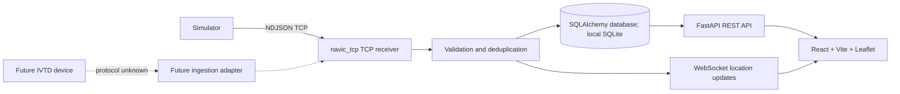

# Architecture

## Data flow

The simulator and future hardware are separate sources. No real IVTD hardware or verified IVTD protocol is available in this project. Simulator frames must retain simulated provenance.

## Folder map

| Path | Purpose |
| --- | --- |
| `frontend/` | Frontend package root, Vite config, React JSX, styles, Leaflet wrappers, API and WebSocket clients |
| `navic_tcp/` | TCP receiver/client, protocol and NMEA handling, persistence-facing models/store, API integration, simulator |
| `backend/python_fastapi/` | FastAPI application and route modules |
| `backend/python_sqlalchemy/` | ORM models, DB configuration, seeds, Alembic migrations |
| `backend/python_services/` | Domain services for auth, alerts, telemetry, email, and fleet operations |
| `backend/tests/`, `tests/` | Backend API/domain and TCP/NMEA tests |
| `scripts/` | Operational helpers, including NMEA replay |
| `config/` | Demo device registry and app configuration |
| `docs/` | Project, architecture, audit, and operating documentation |
| `_archive/`, `backups/` | Preserved historical source and snapshots; not runtime code |

## Data-source concept

The source field describes provenance. `simulator` (or the equivalent simulated flag) identifies generated frames; `test_replay` is reserved for explicit fixture replay; `hardware` is permitted only when a registered physical device reports non-simulated telemetry. A filter must never relabel simulated records as hardware. Unknown measurements remain absent and should render as “Not reported” or “-”.

## Current migration state

The configured local database uses SQLite. A read-only Alembic status command run during baseline reported revision `0004_user_id_password_auth`; migration revisions `0005`–`0007` exist on disk. Migration up/down checks remain NOT TESTED.
